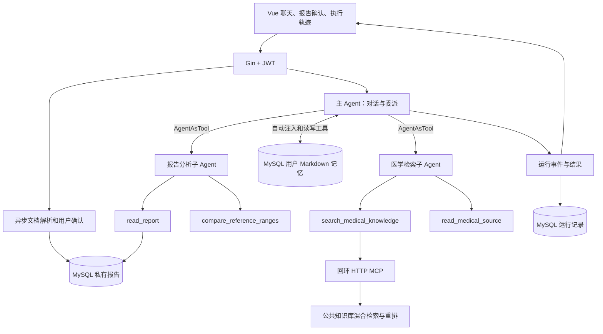

# 医疗 Agent Demo

该版本在原有 Go + Vue 项目上增加报告解读、症状咨询和医学知识检索。入口为菜单中的“医疗 Agent”，聊天模型选择 `medical_agent`。

## 启动与资料准备

1. 使用项目现有 `config/config.toml` 配置 MySQL、Redis Stack、RabbitMQ、Qwen 和 RAG embedding/rerank。Qwen 必须支持原生工具调用。图片和扫描 PDF 需要 `ragModelConfig.ocrAccessToken`；文本 PDF 优先原生提取。
2. 在项目根目录运行 `go run .`。启动迁移创建 `medical_reports`、`medical_runs`、`medical_run_events` 和 `user_memories` 表，并删除已废弃的 `medical_runs.events` 列；不搬迁已有知识库文件。
3. 管理员登录后，在“医学知识库”上传本目录 `knowledge/` 中的三份 Markdown 摘要，等待索引完成。它们是带来源的演示科普资料，不是完整医疗知识库。不要上传个人报告到公共库。医学模式只检索管理员维护的公共资料；原 RAG 模式仍保留原有联合检索行为。
4. `cd vue-frontend` 后运行 `npm run serve`，普通用户登录，进入医疗 Agent。
5. 点击“合成报告样例”，提交文字，待识别后核对并确认。也可上传 PDF/JPG/PNG/TXT，单个文件不超过10MB、抽取文字不超过60000字节。

医疗 MCP 服务在主进程内使用短生命周期的随机回环端口，以随机令牌鉴权，通过真实 Streamable HTTP 初始化和调用。无需启动旧的天气 MCP 模块。检索只访问公共知识，报告由业务服务在校验用户归属后提供给报告工具。

## 架构



主 Agent 和两个子 Agent 都使用 Eino `ChatModelAgent`。工具调用与 ToolMessage 回填由框架处理；子 Agent 使用 `NewAgentTool`，只收到主 Agent 委派的任务。一次主请求最多3次委派，每次子任务最多3次工具调用，合计最多9次（委派本身也计数）。记忆工具另有每轮3次额度；接入记忆的主 Agent 最多7次模型生成（最多6次调用后总结），子 Agent 仍最多4次，工具顺序执行。每次生成前注入剩余预算，预算耗尽后通过模型工具选项禁用继续调用，要求根据已有观察收尾；工具执行端仍独立校验，不能仅靠提示词限制。

每次 `medical_researcher` 委派首次通过模型工具选项强制调用 `search_medical_knowledge`，首次调用完成后，由子 Agent 自主决定总结、改写查询或补充联网搜索；空结果及服务失败也消耗预算，不自动无限重试。`read_medical_source` 返回本次检索得到的片段，不是任意 URL 下载器。模型侧使用委派内的 `S1`、`S2` 短编号，返回时还原为完整来源 ID。后端拒绝未执行检索、未知编号以及非空结论配空引用的结果；无证据时子 Agent 应返回空 findings、evidence，并在 missing 中说明原因。只有同时包含结论和有效引用、且通过校验的研究结果才计为有效证据，来源缓存非空并不足够。该校验不等同于验证医学结论正确，语义正确性仍需人工评测。

流式模式复用现有 SSE 连接，实时传输状态、工具和子 Agent 事件；主 Agent 的正文分片通过 JSON `answer_delta` 事件立即追加显示，不做定时合并。发起证据委派后、尚无有效研究结果时，主 Agent 正文分片暂不下发；主 Agent 可以在预算内再次委派，最终仍无有效证据则丢弃模型结论，由后端返回证据不足说明及已验证的报告指标，并将本轮标记为 `partial`。获得有效研究结果后正常发送正文分片；未发起证据委派的纯追问流程保持原有流式行为。正文分片仅用于实时传输，不加入运行事件列表、不占用持久化序号、不写入数据库，也不进入持久化重试队列。结束时通过 `answer_final` 的 `delta` 字段下发清理来源标记后的完整答案，前端替换正文，并整体保存最终答案与聊天消息；失败时同样替换为兜底答案，然后发送 `run_end`。最终答案事件及工具、子 Agent、来源、运行状态事件继续持久化，新运行的持久化事件从 1 连续编号；已有历史记录不清理、不重编号。

SSE 响应使用 `Cache-Control: no-cache, no-transform` 并逐事件 Flush，保留 `X-Accel-Buffering: no`。`no-transform` 防止 Vue 8080 开发服务器的压缩中间件将小分片缓冲到结束；不需要关闭其他响应的压缩。工具执行期间展示运行轨迹与等待提示，正文在主 Agent 开始回答后逐步显示。不展示模型思维链、工具参数或子 Agent JSON。断开连接会取消 Agent 与检索请求；报告上传的解析是独立异步任务，不随轮询结束取消。修改后需重启后端，使 SSE 响应头生效。

追问结束当前请求，下一轮从SQL加载最近20条聊天消息和最近确认的会话报告。报告确认后绑定会话，另一个会话需要重新上传。没有跨进程检查点恢复；进程重启前未完成的解析在查询时被标为超时，运行记录标记为中断。会话内串行限制适用于单个后端进程，Demo 使用单实例。

## API

所有接口位于 `/api/v3`，要求普通用户JWT。用户身份来自服务端，不能由工具参数指定。

| 接口 | 输入 | 输出 |
|---|---|---|
| `POST /medical/reports` | multipart `file` 或 `text` | 202、报告ID、`parsing` 状态 |
| `GET /medical/reports/:id` | 报告ID | 解析状态、原文、`indicatorsJson` |
| `PATCH /medical/reports/:id` | `indicators` 数组 | 确认后的报告 |
| `GET /medical/runs?sessionId=...` | 会话ID | 本人最近30次运行、`eventsJson` |
| `POST /AI/chat/send-new-session` | `question`、`modelType: medical_agent`、可选 `reportId` | `Information`、`sessionId`、`run` |
| `POST /AI/chat/send` | 上述字段 + `sessionId` | 同上 |
| 两个对应的 `send-stream` 接口 | 同上 | JSON SSE，最后 `[DONE]` |

指标字段都是字符串：`name`、`value`、`unit`、`reference`、`source`。比较工具只接受同单位、双侧数值区间；缺失范围、未知单位、定性值、单侧范围等标记待核对，不做隐式换算。报告确认是人工检查点，OCR提取不应被当作事实。

事件字段包含 `runId`、`sessionId`（实时事件）、`id`、`parentId`、`type`、`agent`、`tool`、`status`、`durationMs`、`summary`、`sources` 或 `delta`。当前事件类型包括 `run_start/run_end`、`subagent_start/subagent_end`、`tool_start/tool_end`、`sources`、`answer_delta`、`answer_final` 和传输层 `error`。

## 验证和评测

```sh
go test ./...
go test -race ./common/medical
# 独立随机临时数据库，不迁移应用库
GOPHERAI_TEST_MYSQL=1 go test ./service/medical ./router -count=1
# 明确启用真实模型；仅使用合成软件测试资料，不访问应用数据
GOPHERAI_MEDICAL_LIVE=1 go test ./common/aihelper -run '^TestMedicalLiveSmoke$' -count=1 -v
cd vue-frontend
npm run lint -- --no-fix
npm run build
```

`scripts/evaluate_medical.py` 提供20条真实模型场景对比，默认 dry-run。完整运行会产生测试会话和私有合成报告；应使用专门的普通测试账号，且其个人知识库为空，避免原 RAG 基线读到额外资料。

```sh
python3 scripts/evaluate_medical.py
# 在终端环境设置 MEDICAL_DEMO_TOKEN 后执行，勿把令牌提交到仓库
python3 scripts/evaluate_medical.py --live --limit 20
```

结果保存为 `outputs/medical-evaluation.json`：保留回答、事件、延迟、实际工具次数、关键词检查、正文内部来源标记残留检查和轨迹来源数量，原 RAG 评测显式传 `judge_enabled: false`。报告场景会确认已知的合成指标，并另存提取结果供核对，不把人工纠正后的成功冒充OCR成功。追问由人工复核是否必要、是否重复；不能将关键词通过率当作临床准确率。

## 3～5分钟录屏脚本

1. 展示项目入口，说明 Go 工程基础与新增 Agent 能力。
2. 提交合成报告，展示OCR/提取结果，手动修改一个字段再确认。
3. 提问“请解读已确认报告，先说明异常项和依据”。展开时间线，展示主 Agent 委派报告子 Agent、调用比较工具、委派检索子 Agent与MCP检索。
4. 回答必要追问，展示会话状态延续与引用来源。实际模型可能根据输入选择不同调用路径，勿伪造固定执行轨迹。
5. 新建会话问“血常规包括哪些指标”，展示只调用医学检索子 Agent。
6. 展示自动测试中的二次检索、预算耗尽和取消验证，以及评测输出中的真实数据。服务异常演示可用无索引的测试环境，不应删除正式资料。

## 面试说明

- 为什么用子 Agent：报告结构处理与证据检索拥有不同工具和上下文，主 Agent 保留对话控制权。
- 为什么保留 Workflow：知识库检索和重排仍是确定性、可评测的组件，Agent 决定何时使用及是否重查。
- 如何控制循环：本地预算、全局预算、模型轮数和请求截止时间共同限制；工具失败作为观察返回，预算/取消则终止。
- 如何说明 MCP：它提供工具协议和传输，不提供规划；自主循环来自 Agent 执行器。
- 当前边界：少量人工整理科普资料、单实例、有限历史、无临床验证；扩展方向是增加有版本的权威资料、效果对比和运行恢复。

简历可用：“基于 Go 与 Eino 实现医疗多 Agent 助手，使用 ReAct 循环、AgentAsTool 委派及 MCP 检索完成报告解读与多轮信息采集，提供报告人工确认、引用来源、执行轨迹和场景评测。”指标只填写实测值。

执行事件逐条落库，完整输入输出及 SQL 分析示例见 [执行事件与 SQL 调试](EVENTS.md)。

## Tavily 联网搜索

医疗检索子 Agent 可通过 `search_web(query)` 按需联网：用户明确要求联网、需要最新信息，或本地知识库证据不足时调用。联网搜索与本地检索共享现有每个子 Agent 最多 3 次、全局最多 9 次工具调用预算。

在 `config/config.toml` 中配置：

```toml
[tavilyConfig]
enabled = true
apiKey = ""
timeoutSeconds = 15
```

启动后端前设置 `TAVILY_API_KEY` 环境变量（优先于配置文件中的 `apiKey`），随后重启后端。请在本机设置真实密钥，不提交到仓库。默认 `enabled=false`；关闭或缺少 Key 时不向模型注册联网工具，知识库检索仍可使用。

使用 Tavily `https://api.tavily.com/search`，固定 basic、最多 5 个结果，关闭自动参数、生成答案与原始全文。不自动重试；超时、鉴权、限流和额度错误显示在调用过程，并允许模型根据已有证据继续回答。服务端只保留内容片段，每条最多 4000 字符；“读取证据片段”不会另行抓取网页全文。提示词要求只外发必要医学检索词，不发送个人身份信息或完整报告；这属于模型行为约束，不是确定性的脱敏过滤。

来源事件新增可选 `kind` 和 `url`，网页来源为 `kind=web`，ID 为 `web_<URL的SHA256>`。来源卡片支持原网页链接，历史记录保留相同信息；旧知识库来源兼容。API Key 不出现在来源、日志或返回的错误正文中。

验证：配置有效 Key 后，提问“请联网查找最新的医学检验资料，并引用来源”，检查 `search_web` 调用、回答正文不含内部来源标记、执行轨迹中的来源 ID、网页来源卡片及刷新后历史恢复。无 Key 的自动化测试使用模拟服务，不代表真实联网验收通过。

医疗 Agent 新生成的回答不要求输出来源 ID，后端在发送和保存前清理残留的内部来源标记。子 Agent 的 `evidence` ID 校验及执行轨迹中的来源 ID、标题、链接、内容保留；已有历史正文不迁移。此处理仅作用于医疗 Agent，不改变 RAG 分支或共用 Markdown 渲染。评测字段 `answer_source_marker_free` 和 `trace_source_count` 替代原 `citation_id_valid`，不代表医学结论正确性。

## 个人档案

医疗 Agent 每轮自动注入当前用户的 Markdown 记忆，并可通过工具自主维护。菜单和聊天页的“个人档案”入口支持预览、编辑和清空，使用版本检查避免并发覆盖。存储、接口、预算与验证说明见 [MEMORY.md](MEMORY.md)。
