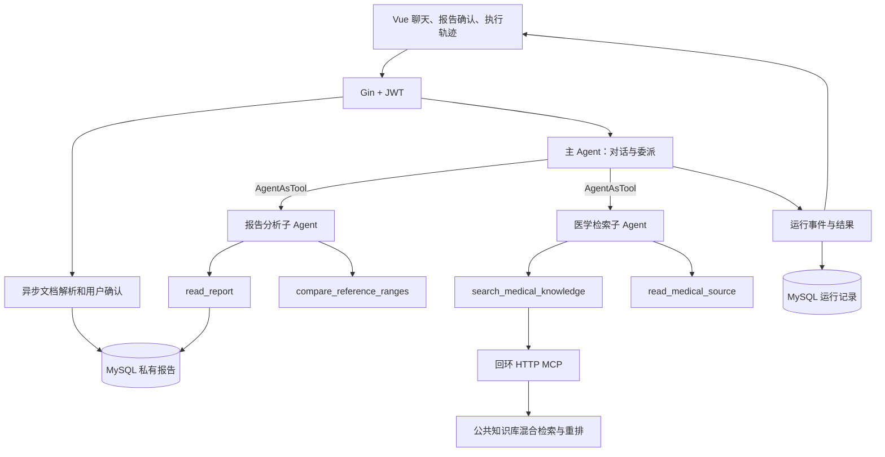

# 医疗 Agent Demo

该版本在原有 Go + Vue 项目上增加报告解读、症状咨询和医学知识检索。入口为菜单中的“医疗 Agent”，聊天模型选择 `medical_agent`。

## 启动与资料准备

1. 使用项目现有 `config/config.toml` 配置 MySQL、Redis Stack、RabbitMQ、Qwen 和 RAG embedding/rerank。Qwen 必须支持原生工具调用。图片和扫描 PDF 需要 `ragModelConfig.ocrAccessToken`；文本 PDF 优先原生提取。
2. 在项目根目录运行 `go run .`。启动迁移新增 `medical_reports` 和 `medical_runs` 两张表；不搬迁已有知识库文件。
3. 管理员登录后，在“医学知识库”上传本目录 `knowledge/` 中的三份 Markdown 摘要，等待索引完成。它们是带来源的演示科普资料，不是完整医疗知识库。不要上传个人报告到公共库。医学模式只检索管理员维护的公共资料；原 RAG 模式仍保留原有联合检索行为。
4. `cd vue-frontend` 后运行 `npm run serve`，普通用户登录，进入医疗 Agent。
5. 点击“合成报告样例”，提交文字，待识别后核对并确认。也可上传 PDF/JPG/PNG/TXT，单个文件不超过10MB、抽取文字不超过60000字节。

医疗 MCP 服务在主进程内使用短生命周期的随机回环端口，以随机令牌鉴权，通过真实 Streamable HTTP 初始化和调用。无需启动旧的天气 MCP 模块。检索只访问公共知识，报告由业务服务在校验用户归属后提供给报告工具。

## 架构



主 Agent 和两个子 Agent 都使用 Eino `ChatModelAgent`。工具调用与 ToolMessage 回填由框架处理；子 Agent 使用 `NewAgentTool`，只收到主 Agent 委派的任务。一次主请求最多3次委派，每次子任务最多3次工具调用，合计最多9次（委派本身也计数）。每个 Agent 最多4次模型生成，工具顺序执行。每次生成前注入剩余预算，预算耗尽后通过模型工具选项禁用继续调用，要求根据已有观察收尾；工具执行端仍独立校验，不能仅靠提示词限制。

`read_medical_source` 返回本次检索得到的片段，不是任意 URL 下载器。重复查询可以拓展本次证据集合。引用校验验证来源ID存在，不等同于验证医学结论正确；这种语义正确性仍需人工评测。

流式模式实时传输状态、工具和子 Agent 事件；最终回答在聚合工具调用并校验引用后，通过 JSON `answer_delta` 事件下发，**当前不是逐 token 输出**。不展示模型思维链。断开连接会取消 Agent 与 MCP 请求；报告上传的解析是独立异步任务，不随轮询结束取消。

追问结束当前请求，下一轮从SQL加载最近20条聊天消息和最近确认的会话报告。报告确认后绑定会话，另一个会话需要重新上传。没有跨进程检查点恢复；进程重启前未完成的解析在查询时被标为超时，运行记录标记为中断。会话内串行限制适用于单个后端进程，Demo 使用单实例。

## API

所有接口位于 `/api/v3`，要求普通用户JWT。用户身份来自服务端，不能由工具参数指定。

| 接口 | 输入 | 输出 |
|---|---|---|
| `POST /medical/reports` | multipart `file` 或 `text` | 202、报告ID、`parsing` 状态 |
| `GET /medical/reports/:id` | 报告ID | 解析状态、原文、`indicatorsJson` |
| `PATCH /medical/reports/:id` | `indicators` 数组 | 确认后的报告 |
| `GET /medical/runs?sessionId=...` | 会话ID | 本人最近30次运行、`eventsJson` |
| `POST /AI/chat/send-new-session` | `question`、`modelType: medical_agent`、可选 `reportId` | `Information`、`sessionId`、`run` |
| `POST /AI/chat/send` | 上述字段 + `sessionId` | 同上 |
| 两个对应的 `send-stream` 接口 | 同上 | JSON SSE，最后 `[DONE]` |

指标字段都是字符串：`name`、`value`、`unit`、`reference`、`source`。比较工具只接受同单位、双侧数值区间；缺失范围、未知单位、定性值、单侧范围等标记待核对，不做隐式换算。报告确认是人工检查点，OCR提取不应被当作事实。

事件字段包含 `runId`、`sessionId`（实时事件）、`id`、`parentId`、`type`、`agent`、`tool`、`status`、`durationMs`、`summary`、`sources` 或 `delta`。当前事件类型包括 `run_start/run_end`、`subagent_start/subagent_end`、`tool_start/tool_end`、`sources`、`answer_delta` 和传输层 `error`。

## 验证和评测

```sh
go test ./...
go test -race ./common/medical
# 独立随机临时数据库，不迁移应用库
GOPHERAI_TEST_MYSQL=1 go test ./service/medical ./router -count=1
# 明确启用真实模型；仅使用合成软件测试资料，不访问应用数据
GOPHERAI_MEDICAL_LIVE=1 go test ./common/aihelper -run '^TestMedicalLiveSmoke$' -count=1 -v
cd vue-frontend
npm run lint -- --no-fix
npm run build
```

`scripts/evaluate_medical.py` 提供20条真实模型场景对比，默认 dry-run。完整运行会产生测试会话和私有合成报告；应使用专门的普通测试账号，且其个人知识库为空，避免原 RAG 基线读到额外资料。

```sh
python3 scripts/evaluate_medical.py
# 在终端环境设置 MEDICAL_DEMO_TOKEN 后执行，勿把令牌提交到仓库
python3 scripts/evaluate_medical.py --live --limit 20
```

结果保存为 `outputs/medical-evaluation.json`：保留回答、事件、延迟、实际工具次数、关键词检查和来源ID有效性，原 RAG 评测显式传 `judge_enabled: false`。报告场景会确认已知的合成指标，并另存提取结果供核对，不把人工纠正后的成功冒充OCR成功。追问由人工复核是否必要、是否重复；不能将关键词通过率当作临床准确率。

## 3～5分钟录屏脚本

1. 展示项目入口，说明 Go 工程基础与新增 Agent 能力。
2. 提交合成报告，展示OCR/提取结果，手动修改一个字段再确认。
3. 提问“请解读已确认报告，先说明异常项和依据”。展开时间线，展示主 Agent 委派报告子 Agent、调用比较工具、委派检索子 Agent与MCP检索。
4. 回答必要追问，展示会话状态延续与引用来源。实际模型可能根据输入选择不同调用路径，勿伪造固定执行轨迹。
5. 新建会话问“血常规包括哪些指标”，展示只调用医学检索子 Agent。
6. 展示自动测试中的二次检索、预算耗尽和取消验证，以及评测输出中的真实数据。服务异常演示可用无索引的测试环境，不应删除正式资料。

## 面试说明

- 为什么用子 Agent：报告结构处理与证据检索拥有不同工具和上下文，主 Agent 保留对话控制权。
- 为什么保留 Workflow：知识库检索和重排仍是确定性、可评测的组件，Agent 决定何时使用及是否重查。
- 如何控制循环：本地预算、全局预算、模型轮数和请求截止时间共同限制；工具失败作为观察返回，预算/取消则终止。
- 如何说明 MCP：它提供工具协议和传输，不提供规划；自主循环来自 Agent 执行器。
- 当前边界：少量人工整理科普资料、单实例、有限历史、无临床验证；扩展方向是增加有版本的权威资料、效果对比和运行恢复。

简历可用：“基于 Go 与 Eino 实现医疗多 Agent 助手，使用 ReAct 循环、AgentAsTool 委派及 MCP 检索完成报告解读与多轮信息采集，提供报告人工确认、引用来源、执行轨迹和场景评测。”指标只填写实测值。
